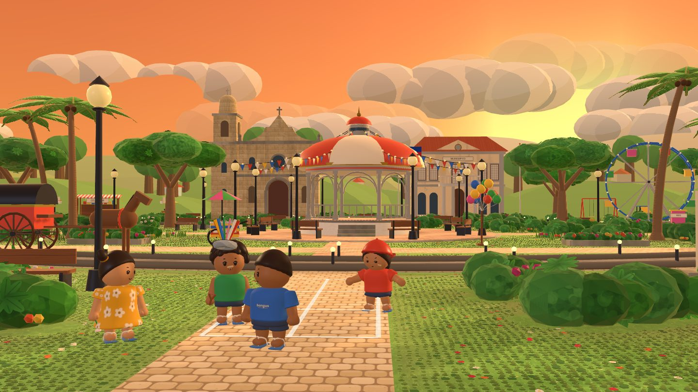
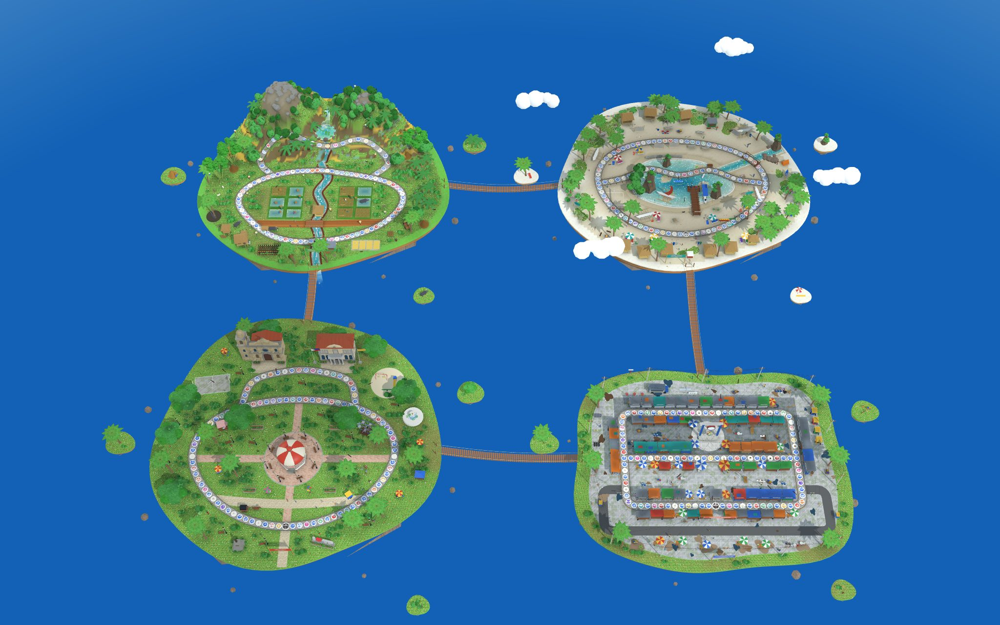

<div align="center">

# Taympers

**Ang mga laro sa kalye, nasa ulap na.**<br>
<sub>The street games, now up in the clouds.</sub>

A 3D party board game built on Filipino street games. Up to four kids race around a floating island, collect
piso, buy korona, and settle every round with Tumbang Preso, Patintero, Sipa or another game from the street.

**[▶ Play Taympers](https://taympers.vercel.app/)** · **[GitHub repository](https://github.com/Muj-csv/Level-Up-3.0-Hackathon)**

[](https://taympers.vercel.app/)




**Team Langit Lupa** · Angeles University Foundation<br>
Level Up 3.0 Esports Game Dev Challenge, Student Category

</div>

---

## Contents

- [Game overview](#game-overview)
- [Play Taympers](#play-taympers)
- [Features at a glance](#features-at-a-glance)
- [Game modes](#game-modes)
- [Characters and maps](#characters-and-maps)
- [Gameplay and rules](#gameplay-and-rules)
- [The eight street-game minigames](#the-eight-street-game-minigames)
- [Controls and settings](#controls-and-settings)
- [Technology and architecture](#technology-and-architecture)
- [Running it locally](#running-it-locally)
- [Repository structure](#repository-structure)
- [Testing](#testing)
- [Deployment](#deployment)
- [Offline, compatibility and limitations](#offline-compatibility-and-limitations)
- [Troubleshooting](#troubleshooting)
- [Credits and licences](#credits-and-licences)
- [AI use](#ai-use)
- [Team Langit Lupa](#team-langit-lupa)

---

## Game overview

**"Taym pers!"** is what Filipino kids shout to call a time-out in the middle of a street game. In
Taympers, the street games themselves are the game.

Taympers puts two kinds of play in one match:

- **A board game.** Each player rolls a die, moves around an island, lands on spaces that give or take
  piso (the coins), picks up items, and buys **korona** (crowns) when they walk past one with enough piso.
- **A street-game minigame after every round.** All four players play the same game at once: knock down
  the can in Tumbang Preso, slip past the guards in Patintero, keep the sipa in the air. The prize money
  goes straight back into the board game.

That link is what sets it apart from a plain digital board game or a minigame collection. A good Palosebo
climb pays for the korona you buy next turn, and a bad roll can still be made up in Luksong Tinik. Luck
(the die, Swerte spaces, Jack en Poy), strategy (when to shop, which path to take at a fork, whether to
pay for a ride) and skill (the minigames) all matter, and every round ends with everyone playing together.

Each street game also comes with how it is played on a real street and how to try it outside, so the
game points players back to the games it is built on. Taympers was made for the Level Up 3.0 Esports Game
Dev Challenge (Student Category) and covers two of its themes: **Philippine Games and Sports**, and
**Board Games / Brain Games**.

## Play Taympers

| | |
|---|---|
| **Live game** | **https://taympers.vercel.app/** (rebuilt from `main` on every push) |
| **Backup copy** | https://muj-csv.github.io/Level-Up-3.0-Hackathon/ (GitHub Pages, also from `main`) |
| **Source code** | https://github.com/Muj-csv/Level-Up-3.0-Hackathon |

It runs in the browser on phones, tablets and computers. There is nothing to install.

**To start a game:**

1. Open the link, wait for the loading bar and tap **Pindutin para magsimula**.
2. Tap **Maglaro**. Choose **Party** or **Torneo**, the number of rounds and the bot level (Madali, Sakto
   or Mahirap).
3. Under **Ilang tao**, choose how many people are playing on this device (1 to 4) and type their names.
   Bots take the remaining seats.
4. Tap **Simulan**. In Party, pick an island on the map screen and tap **Laro na!**

First-time players get a six-step guide over the real board before their first roll. **Paano maglaro** on
the title screen explains everything again.

### One device or online

| | Shared device | Online rooms |
|---|---|---|
| **How** | Up to 4 people take turns on one phone, tablet or computer | One phone per player; the host makes a room, the others scan its QR code or type its 4-letter code |
| **Empty seats** | Bots | Bots |
| **Minigames** | Every person gets their own lane on the screen and their own key | Each player plays on their own phone |
| **Internet** | Only for the first visit; after that it works offline (see [Offline](#offline)) | Needed for the whole game |
| **Start from** | **Maglaro** | **Maglaro online** |

Online rooms run on Supabase Realtime. See [Online rooms](#online-rooms) for what has and hasn't been
tested.

## Features at a glance

| Feature | What it is |
|---|---|
| **3D islands** | Every board, kid and minigame arena is drawn in 3D with Three.js, with a flat 2D board when 3D isn't available |
| **Four island maps** | Plaza, Palengke, Aplaya and Palayan, each with a fork, a paid shortcut ride and its own event spaces |
| **Four playable kids** | Jun, Neneng, Totoy and Bunso, rigged 3D characters with animations and faces |
| **Eight street games** | Tumbang Preso, Patintero, Sipa, Palosebo, Luksong Tinik, Pukpok Palayok, Taguan and Piko |
| **Modes** | Party, Torneo, Hamon ng Araw (daily challenge) and Pagsasanay (practice) |
| **Board economy** | Piso, korona, four items, a Sari-sari store, Jack en Poy duels, Kasama allies and Tanong ni Lola trivia |
| **Bots** | Three levels (Madali, Sakto, Mahirap) that shop, ride and pick rivals differently |
| **Pasaporte ng Laro** | A stamp for every street game played, and a gold stamp for playing it for real outside |
| **Saved games** | Local games save at the start of every turn and resume from the title screen |
| **Offline play** | After one visit online, the game opens and plays on that device without internet |
| **Settings** | Music, sound effects, vibration, graphics quality (Kalidad) and the language of the rules and trivia (Wika) |
| **Accessibility** | Keyboard play, buttons at least 44 px tall, focus kept inside dialogs, reduced-motion support |
| **Online rooms** | Up to 4 phones by QR code or room code, with reconnecting and bot takeover |

## Game modes

### Maglaro: Party

The full game. Players roll, move, land on spaces, buy items and collect korona, and every round ends
with a street-game minigame. A game lasts **3, 5 or 8 rounds**. The last round is **Huling Hirit**: the
minigame prizes are doubled and the player in last place gets help. After the last minigame, three kinds
of **bonus korona** are handed out. The game ends with the standings, a picture of the result to share,
and a rematch button. The rules are in [Gameplay and rules](#gameplay-and-rules).

### Maglaro: Torneo

Minigames only. There's no die and nobody moves on the board. Players play **3 or 5** street games, and
each game's winner gets **1 korona** (players tied for first all get one). The usual piso prizes are
still paid and break ties. Torneo is played in front of an island, Plaza by default.

### Hamon ng Araw

A solo daily challenge, opened from the title screen. Each day picks one street game: the same game and
the same three Mahirap bots for everyone that day. You can retry as often as you like. Every score is
kept in a list on the device, and a new best is celebrated.

### Pagsasanay

Practice, opened from Hamon ng Araw. Pick any of the eight street games and play it alone against three
Sakto bots. Your best score in each game is kept on the device.

### Pasaporte ng Laro

The **Pasaporte** on the title screen holds a stamp for each street game you have played in the app. It
also holds the **Album ng Laro**, a card for each game with a picture, a one-line description and its
stamp. **Ipakita ang detalye** opens how the game is played on a real street, how to try it outside
(**Subukan sa labas**), its rules in the app, and a button to mark that you played it for real, which
gives the card a **gold stamp**. Every minigame's result card also shows its "Subukan sa labas" tip.
The Pasaporte is kept on the device.

### Online play

**Maglaro online** → **Gumawa ng room** makes a room with a QR code and a 4-letter code, and the others
use **Sumali**. The host picks the map, rounds and bot level, then presses **Simulan ang laro**; empty
seats become bots. A dropped player keeps their seat for 60 seconds, then a bot plays for them until they
come back. Every phone runs the game from the same seed and only the players' choices are sent, so all
phones show the same board, piso and korona.

The finals guide, checklist and troubleshooting table for online play are in
[`docs/ONLINE.md`](docs/ONLINE.md).

## Characters and maps

### The kids

| Kid | Colour | Look |
|---|---|---|
| **Jun** | Red | Red tee, cap worn backwards, cheek bandage |
| **Neneng** | Yellow | Yellow floral dress, pigtails, holds a flower |
| **Totoy** | Blue | Blue tee with a *bangus* print, bowl cut |
| **Bunso** | Green | Green tank top, curly hair, nose bandage, gap teeth, a tirador (slingshot) |

The four kids are the players' pieces on the board, their portraits in the HUD, and the players in every
minigame. They have no special abilities; every kid plays by the same rules. Each is a rigged 3D figure
built in code, with animations (walk, run, jump, kick, throw, wave, victory, defeat and more) and eight
facial expressions that follow what happens in the game. Four barrio kids, **Lito, Mayumi, Boyet and
Dodong**, use the same rig as Kasama allies, guards and the crowd. **Mga karakter** on the title screen
shows the four kids in 3D.

### The islands



| Map | Setting | Side path | Shortcut ride | Island spaces |
|---|---|---|---|---|
| **Plaza** | Town plaza: kiosko, simbahan, munisipyo, bantayog | A path past the church | Kalesa, 8 piso | Banda, Kampana, Munisipyo, Rizal |
| **Palengke** | Wet and dry market with a timbangan | A middle aisle through the stalls | Padyak, 8 piso | Tawad, Timbangan, Suki, Basa, Ulan |
| **Aplaya** | Beach, lagoon and pantalan | A boardwalk over the water | Bangka, 6 piso | Alon, Huli, Buko, Taog, Araw |
| **Palayan** | Rice terraces and a waterfall | A trail up the terraces | Kariton ng kalabaw, 8 piso | Tanim, Ani, Bayanihan, Balang, Ulan |

Every island board is an **80-space loop** with a side path of 22 to 26 spaces that forks off and joins
it again. At the fork, the player chooses the way, and each button says how many steps it is to the
nearest korona that way. The shortcut's stop is 12 to 15 spaces after **Simula** (the start). Stopping
there, or passing it with enough piso, offers a paid ride 28 to 56 spaces ahead, and the move ends at
the far stop.

Each island has 10 places where a korona can sit, with **4 korona** on the board at a time. When one is
bought, it flies to a new place that someone can reach. The title screen is a separate Plaza scene at
golden hour, where the four kids play sipa and patintero on a 12-second loop.

## Gameplay and rules

### A Party game, step by step

1. **Set up.** Choose the mode, rounds, bot level, the number of people and the island.
2. **Turn order.** A draw (**Bunutan**) decides who goes first. Everyone starts with **10 piso**.
3. **Roll.** Tap **Tamaan ang dice** to roll 1 to 10. Spaces you can reach get a white ring, and each
   korona shows how many steps away it is. Use an item before rolling if you want to.
4. **Move and land.** Your kid walks the board, and you choose the path at the fork. Walking past a
   korona with 10 piso lets you buy it, and passing the Sari-sari store with empty hands lets you shop.
   The space you stop on then takes effect.
5. **End of the round.** When all four players have moved, everyone plays a street-game minigame, and
   the prizes are paid in piso.
6. **Repeat** for every round. The last round is **Huling Hirit**.
7. **Finish.** Bonus korona are awarded, and the winner is named **Bida ng Isla**.

**Win condition:** the most korona at the end wins. Piso break ties.

### Spaces

| Space | Effect |
|---|---|
| **Simula** (start), **Piso** | +3 piso |
| **Utang** | −3 piso |
| **Swerte** | Luck: +5 or +8 piso, or a free Kendi or Agimat |
| **Tikbalang** | Pushed back 3 spaces |
| **Sari-sari** | The shop: buy one item |
| **Jack en Poy** | Pick any rival for rock-paper-scissors (bato, papel, gunting); the winner takes up to 5 piso |
| **Kasama** | A barrio kid joins you and adds 1 or 2 steps to every roll, up to 2 friends (+3 piso if you already have both) |
| **Tanong ni Lola** | A three-choice question about Filipino games and places; +5 piso if right |
| **Korona** | 10 piso, bought by walking past or stopping on it |

### Island spaces

| Island | Spaces |
|---|---|
| **Plaza** | Banda: march 3 spaces forward · Kampana: +5 · Munisipyo: a free Kendi or Agimat (+3 if your hands are full) · Rizal: a Tanong ni Lola question |
| **Palengke** | Tawad: +3 · Timbangan: +2 · Suki: a free item or +3 · Basa: slip back 2 · Ulan: buy an umbrella, −2 |
| **Aplaya** | Alon: forward 2 · Huli: +4 · Buko: a free item or +3 · Taog: back 2 · Araw: buy water, −2 |
| **Palayan** | Tanim: +2 · Ani: +5 · Bayanihan: +2 for every player · Balang: −4 · Ulan: the rice is watered, +3 |

### Items

You carry one item at a time. Buy items at the Sari-sari store, or get one free from Swerte or an island
space.

| Item | Cost | Effect |
|---|---|---|
| **Kendi** | 3 piso | +3 steps on your roll |
| **Agimat** | 4 piso | Blocks the next loss from Utang, Tikbalang, a lost Jack en Poy or a bad island space; works on its own |
| **Dobleng dice** | 5 piso | Roll two dice: 2 to 20 steps |
| **Gintong dice** | 8 piso | Choose your number, 1 to 10; the picker shows where each number lands |

### Minigame prizes, Huling Hirit and bonus korona

| Rule | Details |
|---|---|
| **Minigame prizes** | 1st +10 piso, 2nd +5, 3rd +3 (tied players share the place) |
| **Huling Hirit** | Last round of a Party game of 3 or more rounds: double prizes, and the player in last place gets a free Dobleng dice (or +5 piso if they already hold an item) |
| **Hari ng Laro** | +1 korona at the end for the most minigame wins |
| **Mayaman** | +1 korona for the most piso |
| **Malas sa Dice** | +1 korona for the lowest average roll, as consolation for bad luck |

Players tied for a bonus all get it. A bonus where everyone is tied isn't given.

### Bots

| Level | How they play |
|---|---|
| **Madali** | Uses items at once, sometimes picks a fork path at random, plays minigames loosely |
| **Sakto** | Saves items for a korona it can afford, keeps 10 piso in reserve when shopping, picks its Jack en Poy rival |
| **Mahirap** | Like Sakto, but plays minigames better, answers more trivia right, and goes after the leader |

## The eight street-game minigames

One street game is played after every round, and none repeats until all eight have been played. Before
each one, its card explains the controls. With one person on the device, the action is a tap, **Space**,
**Enter** or **A**. With several people, each person taps their own lane or presses their own key
(**A**, **F**, **J**, **L**).

| Game | Objective | How you play it | On the real street |
|---|---|---|---|
| **Tumbang Preso** | Knock the can down with your tsinelas | A line sweeps back and forth: throw when it is in the white middle. 5 throws each, getting faster | A taya guards a can in a circle; players knock it down with their slippers and grab them back before being tagged |
| **Patintero** | Cross every line without getting tagged | Drag a finger or use the arrow keys / WASD. +2 per line going out, +3 coming back, +5 for reaching Bahay; a tag sends you home. Each person on the device gets one run | Guards may only move along lines drawn on the ground, sometimes with water (hence *tubigan*) |
| **Sipa** | Keep the sipa in the air | Kick when your circle glows. Kicking too early or mashing costs you a moment. It gets faster | A small weight with paper or cloth strips, kicked up with the inside of the foot or the knee |
| **Palosebo** | Climb the greased bamboo pole | Tap when the hand turns green; tapping too fast makes you slip. Reach the prize within 12 seconds; faster climbs earn a bonus | A fiesta game: racing up a greased pole to a prize at the top |
| **Luksong Tinik** | Jump the rising "tinik" of hands and feet | Run in and jump when your foot is on the yellow line. A mistimed jump ends your game; each level is higher and faster | Two players stack their feet, then their hands, and the others jump over without touching |
| **Pukpok Palayok** | Break the clay pot while blindfolded | See how far the pot is, then count your steps blindfolded and swing once. Basag (break) 10, sagi (graze) 6, malapit (close) 3; 3 tries. Don't trust the crowd's shouts | A pot of candy hangs from a rope; a blindfolded, spun player swings a stick while the crowd calls out, truthfully or not |
| **Taguan** | Find the kids hiding in the yard | The taya walks by itself and stops at each spot. Tap on a kid's clue (tsinelas, braid, eyes, shadow, giggle, rustle, fingers): +10. The cat, chicken and dog are only animals: a wrong tap is −2 and locks you out for 2 spots. Two rounds | Hide and seek, with the taya singing *"Tagu-taguan, maliwanag ang buwan…"* while counting |
| **Piko** | Hop through as many chalk courts as you can in 20 seconds | A quick press is one foot, a held press is two feet. Skip the box with the pamato. A wrong hop is **Patay!**: back to the start, losing that court's steps. +2 per finished court; three court shapes | Hopscotch: toss the pamato, hop the boxes, skip its box and pick it up on the way back |

In 3D, every minigame has its own arena, with cheering kids at the higher Kalidad settings. Each one also
has a 2D version for devices without 3D.

## Controls and settings

### Controls

| Input | Where | What it does |
|---|---|---|
| Tap the big button, or **Space** / **Enter** | Board | Roll the die; continue |
| **M** | Board | Show the whole map |
| **Esc** | In a game | Open the pause menu |
| **Esc** | Any card or dialog | Go back or close |
| **Tab** | Menus and cards | Move between buttons; focus stays inside the open card |
| **Arrow keys** | Map screen | Pick an island |
| Tap, **Space**, **Enter** or **A** | Minigames, one person | The game's action |
| Own lane, or **A**, **F**, **J**, **L** | Minigames, 2 to 4 people | One lane and one key per person |
| Drag, **arrow keys** or **WASD** | Patintero | Move the runner |
| Quick press or hold (key or button) | Piko | One foot or two feet |

### Settings

The pause button opens the menu. It pauses local games and holds these settings, which are kept on the
device:

| Setting | Choices | Notes |
|---|---|---|
| **Musika** | On / off | Background music |
| **Tunog** | On / off | Sound effects |
| **Vibrate** | On / off | Short vibrations, on phones whose browser supports them |
| **Kalidad** | Mababa / Katamtaman / Mataas | Graphics quality: pixel density, shadows and foliage (see below). Only shown when the device can draw 3D. Katamtaman is the default |
| **Wika** | Filipino / English | Shows the rules and trivia cards in English (also the **FIL/EN** button on the title screen). Buttons and the rest of the game stay in Filipino for now |

The menu also has **Paano maglaro** (the guide), which can show the first-game guide and tips again, and
**Umalis sa laro** (leave the game).

| Kalidad | Pixel density cap | Shadows | Island foliage |
|---|---|---|---|
| **Mababa** | 1× | A round shadow under each kid | Lightest |
| **Katamtaman** | 1.5× | 1024 px sun shadow | Medium |
| **Mataas** | 2× | 2048 px sun shadow; buildings and trees cast shadows too | Densest |

**Resuming:** local games save at the start of every turn. If the page closes, **Ituloy ang laro** on the
title screen picks up where you were.

**Reduced motion:** when the device asks for reduced motion, the game drops screen shake, sway and long
wipes, the title scene stays still, and the splash skips its animations.

## Technology and architecture

Taympers is a static web game: HTML, CSS and plain JavaScript, with no framework, no bundler and no build
step. The whole game is `index.html`, and the 3D islands and kids are JavaScript modules loaded next to it.

| Layer | What is used | Notes |
|---|---|---|
| Game and UI | `index.html`: HTML, CSS and one JavaScript program | Rules, bots, minigames, menus, saves and online sync |
| 3D | [Three.js](https://threejs.org/) r184 (WebGL), bundled in `vendor/three-r184/` | Islands, kids, minigame arenas and the title scene, all built in code (no model files) |
| 2D | HTML canvas | The HUD, and the flat board and minigames used when 3D can't run |
| Sound | Web Audio API | All music and sound effects are synthesized in code; there are no audio files |
| Text | `content/fil.json`, `content/en.json`, `content/terms.json` | Trivia, minigame rules and real-street notes, kept apart from the code for review and translation |
| Offline | `sw.js`, a service worker | Keeps a copy of every game file in the browser |
| Storage | `localStorage` and `sessionStorage` | Settings, the saved game, Pasaporte stamps and scores stay on the device |
| Online rooms | [Supabase](https://supabase.com/) Realtime through `@supabase/supabase-js` 2.118.0 (`vendor/`) | Loaded only when a player opens online play; the game holds only the public project URL and publishable key |
| QR codes | qrcode-generator 1.4.4 (`vendor/`) | The room's QR code |
| Fonts | Bagel Fat One and Nunito, self-hosted in `vendor/fonts/` | No request leaves the site when the game loads |
| Hosting | Vercel (`vercel.json`), with GitHub Pages as a backup | Static files only |
| Tests (development only) | Node.js 18+ and Playwright 1.56.1 | Never shipped to players |

**Why it is built this way:**

- **No build step.** The same files run on Vercel, GitHub Pages, a local server or an itch.io zip, and a
  teammate can change one file and refresh.
- **Bundled libraries and fonts.** A phone at the venue never waits on a CDN, and the whole game can be
  kept for offline play.
- **3D with a 2D fallback.** The 3D drawing is a layer over one set of game rules. When WebGL or Three.js
  isn't available, the same game runs on a flat canvas board with pictures rendered from the 3D kids
  (`kids/sprites.png`). Only the island being played is loaded, when the game starts.
- **A seeded game.** Dice, bots, board events and the minigame order all come from one random seed. An
  online game sends only the players' choices, and every phone works out the same result from them.
- **Network first, then the saved copy.** The service worker fetches the game's files from the network,
  so a new deploy reaches a device as soon as it is online. The saved copy is used offline, or when the
  network hasn't answered in 4 seconds.

## Running it locally

The game itself has no install or build step. It does need to be served over http, because browsers
don't load the 3D modules from a `file://` page; opened as a file, the game falls back to the flat 2D
board.

```bash
git clone https://github.com/Muj-csv/Level-Up-3.0-Hackathon.git
cd Level-Up-3.0-Hackathon
python3 -m http.server 8000
```

Then open **http://localhost:8000**. On Windows, use `py -m http.server 8000` if `python3` isn't found;
any static file server works. Phones on the same Wi-Fi can open `http://<your computer's IP>:8000`. They
get the whole game except the offline copy, which needs https or `localhost`.

Useful switches for testing (add them to the address):

| Switch | Effect |
|---|---|
| `?lang=en` | Opens the English cards for this visit without saving the choice |
| `?perf` | Shows a frame-time readout in the corner |
| `?debug` | Turns on the test hook (`window.__lsu`) and skips the splash and the first-game guide |
| `?debug&speed=N` | Runs N simulation steps per frame |
| `?debug&mg=<key>` | Makes every round use one minigame (for example `mg=piko`) |
| `?debug&splash`, `?debug&tour`, `?debug&sw` | Brings back the splash, the guide or the offline copy under `?debug` |

## Repository structure

```text
Level-Up-3.0-Hackathon/
├── index.html          The game: rules, bots, minigames, menus, 2D and 3D drawing, saves, online sync
├── sw.js               Service worker: the offline copy of every game file
├── content/            Game text: fil.json (Filipino), en.json (English), terms.json (protected terms)
├── maps/               The four 3D islands, board data (boards.js), the title scene and world/ pictures
├── kids/               The four rigged 3D kids, the splash kids and the 2D sprite sheet
├── vendor/             Bundled Three.js, Supabase JS, QR library and fonts, with their licences
├── tests/              Playwright play-tests and stand-ins for the online services
├── tools/              Scripts that render the map pictures and sprites, and export the boards and text
├── docs/               Plans, finals guides, performance findings and content review packets
├── supabase/           A draft database schema for a later phase; not applied anywhere
├── game-core-draft/    An unused experiment that ports the rules to plain modules, with unit tests
├── vercel.json         Vercel settings: static files, cache and security headers
├── .vercelignore       Keeps the tests, tools and docs out of the deploy
├── package.json        Test scripts and the Playwright dev dependency only
└── DEVLOG.md           Work log and AI-use record
```

**Further reading**

| Document | What it covers |
|---|---|
| [`docs/LINKS.md`](docs/LINKS.md) | Every project link: live game, previews, repo, Vercel, contest dates |
| [`docs/PRD.md`](docs/PRD.md) | Team roles and the work plan up to the finals |
| [`docs/BUILD_PLAN.md`](docs/BUILD_PLAN.md) | The longer-term plan after the finals |
| [`docs/ONLINE.md`](docs/ONLINE.md) | How online rooms work, the finals demo script and checklist |
| [`docs/F10_PERFORMANCE.md`](docs/F10_PERFORMANCE.md) | Download size, offline play, the Kalidad setting and draw-call measurements |
| [`docs/F11_HANDOFF.md`](docs/F11_HANDOFF.md) | Release-readiness results: UI, characters, performance and bot simulations |
| [`docs/WRITING.md`](docs/WRITING.md) | How the Filipino and English text is written |
| [`docs/CONTENT_REVIEW_PACKET.md`](docs/CONTENT_REVIEW_PACKET.md) | Every trivia question and game fact, ready for expert review |
| [`docs/PLAYTEST_PLAN.md`](docs/PLAYTEST_PLAN.md), [`docs/DEVICES.md`](docs/DEVICES.md) | The playtest protocol and the demo-device roster |
| [`maps/README.md`](maps/README.md), [`kids/README.md`](kids/README.md), [`vendor/README.md`](vendor/README.md) | The islands, the kids and the bundled libraries |
| [`tests/README.md`](tests/README.md) | What each automated test checks |

## Testing

The automated tests open the real `index.html` in headless Chromium and play it. They need Node.js 18 or
newer:

```bash
npm install
npx playwright install chromium
npm test
```

`npm test` runs every suite in turn. Each one can also be run alone, for example `npm run test:play` or
`node tests/minigames.mjs`.

| Suite | What it checks |
|---|---|
| `play.mjs` | Phone, tablet and desktop sizes; every title button; the map screen; full Party and Torneo matches with every korona accounted for; the daily challenge; bots per level; save and resume; resizing and reduced motion |
| `minigames.mjs` | Every street game against scripted players: good timing must beat button-mashing, and each game's bots stay inside their level's range |
| `3d.mjs` | The 3D build through software WebGL: islands, reach rings, the Kalidad levels, the splash, the gallery, every minigame arena, and the flat-board fallback |
| `online.mjs`, `online-mg.mjs` | Two browsers play a full online match, and a Torneo of each newer minigame, through a stand-in room; both must agree on every score |
| `quality.mjs` | The Kalidad setting: saving it, its effect on each screen, changing it mid-game, and no GPU memory piling up |
| `offline.mjs` | The service worker saves every game file, and with the test server shut down the game reloads and plays an island in 3D |
| `content.mjs`, `lang.mjs` | The English text matches the Filipino entry for entry, and the Wika switch works and falls back to Filipino |
| `regress.mjs`, `ux.mjs`, `hamon-online.mjs` | The Oct 25 playtest bug fixes, the Pasaporte and first-game guide, and the (switched-off) online Hamon scores |

More checks run on demand: `node tests/rejoin.mjs` (drop-outs and reloads), `node tests/four.mjs` (four
phones and the Supabase message budget), `node tests/online.mjs live` and `node tests/online-mg.mjs live`
(against the real Supabase project; need internet), and `npm run perf` (a benchmark of about 15 minutes
per quality level). The draft in `game-core-draft/` has its own unit tests (`node --test`). Details are in
[`tests/README.md`](tests/README.md), and the test runs for each change are recorded in
[`DEVLOG.md`](DEVLOG.md).

**What the automated tests can't tell you.** Software WebGL draws on the CPU, so its frame times say
nothing about real phones, and the online stand-in has no real network delay. Testing on the real demo
devices and on the venue network is done by hand, and it's still open (see
[Known limitations](#known-limitations)).

## Deployment

### Vercel (the live game)

The repository is ready to import as is:

1. On vercel.com, choose **Add New → Project** and import `Muj-csv/Level-Up-3.0-Hackathon`.
2. Keep the settings Vercel reads from `vercel.json`: no framework, no install command, no build command,
   and the repository root as the output. Press **Deploy**.
3. Every push to `main` then redeploys the live game. Pushes to other branches get their own preview
   links. Use these for team testing before a merge; Vercel may ask visitors to log in.

`vercel.json` also caches `vendor/` for a year (each file name carries its version), serves `sw.js` with
`no-cache` so a new offline copy is picked up at once, and adds basic security headers. `.vercelignore`
leaves out the tests, tools, docs, `DEVLOG.md` and `package.json`, so Vercel never installs the test
tools.

### GitHub Pages (the backup)

Under **Settings → Pages**, choose **Deploy from a branch → `main` / root**. Every push to `main`
republishes it. `.nojekyll` makes Pages serve the files as they are.

### itch.io

Zip `index.html` and `sw.js` with the `content/`, `kids/`, `maps/` and `vendor/` folders, upload the zip,
and mark it **"This file will be played in the browser"**. This route hasn't been tried with the current
build.

### Before an event

Open the game once while online on every demo device, the day before and again on the morning of the
event, and check that the Supabase project is awake. The full checklist is in
[`docs/ONLINE.md`](docs/ONLINE.md#before-the-event-checklist).

## Offline, compatibility and limitations

### Offline

After one visit online, the game opens and plays on that device with no internet: Party, Torneo, Hamon ng
Araw, Pagsasanay and the Pasaporte, in 3D. This works on Vercel, GitHub Pages and a local server
(`localhost`). It doesn't work from a `file://` copy or inside the Claude artifact.

- New versions arrive whenever the device is online. The saved copy is only used offline, or on a very
  slow network.
- Online rooms always need internet.
- iPhones and iPads can clear a site's saved data after a few weeks without a visit. Open the game again
  on those devices shortly before an event.
- Until the first visit has loaded fully, nothing has been saved yet, so the game can't open offline.

### Online rooms

| Where the game is opened | Online rooms |
|---|---|
| Vercel or GitHub Pages | Available, through Supabase Realtime (both live builds carry the Supabase settings) |
| A local server | Available while the computer is online |
| The original Claude artifact | Uses Claude's room service, for signed-in, invited users; the artifact is an older, private version of the game |
| A copy without the Supabase settings | **Maglaro online** says online play isn't available there, and offers a game on one device |

Limits worth knowing:

- Rooms hold up to 4 phones. The project is on Supabase's free plan, where one busy room at a time is
  safe: a four-phone test peaked at 54 messages per second, against the plan's limit of 100.
- A free Supabase project pauses after a week without use, and has to be restored from the dashboard
  before an event.
- A player who opens the link in a new tab joins as a new player and can't take back their old seat.
- The automated tests play online games between browsers on one computer, through a stand-in room, and
  have live modes that run the same checks against the real Supabase project. A game between real phones
  on the venue network is still on the checklist.
- The online Hamon ng Araw leaderboard is built but switched off, and will stay off until a nickname
  picker replaces the free-text name field.

### 3D and performance

- 3D needs WebGL. Without it, or if Three.js can't load, the game switches to the flat 2D board by itself,
  and the Kalidad setting is hidden.
- Each island draws about 310,000 to 560,000 triangles, depending on the island and the Kalidad level.
  Building an island takes a few seconds, behind a loading card, when the game starts.
- **On a slow phone or tablet, set Kalidad to Mababa.** Pixel density is the biggest cost.

### Known limitations

| Status | Item |
|---|---|
| Not yet measured | Frame rates on real phones and tablets. All 3D measurements so far come from headless Chromium with software WebGL |
| Not yet tested | Offline play in airplane mode on a real iPhone and Android phone; a multi-phone online game on the venue network |
| Pending review | The trivia and street-game facts are drafts waiting for review by a teacher or cultural expert ([`docs/CONTENT_REVIEW_PACKET.md`](docs/CONTENT_REVIEW_PACKET.md)) |
| Pending playtest | Minigame timing and difficulty (for example Piko's hold and Pukpok Palayok) with kids on real phones |
| Partial | English covers the rules and trivia cards; the rest of the interface is in Filipino |
| Planned | A nickname picker (its word lists are already in `content/fil.json`), more islands, and the two games listed as coming soon in the Pasaporte (Agawan Base and Sungka) |

## Troubleshooting

| Problem | What to try |
|---|---|
| The first load is slow | The first visit downloads about 3.6 MB of game files. Later visits use the saved copy |
| The islands show as a flat board | The device or browser has no WebGL, or the page was opened from a file. Use the live link or a local server |
| The game stutters on a phone | Set **Kalidad** to **Mababa** in the pause menu. The change applies at once, and the island is rebuilt in the background |
| **Ituloy ang laro** isn't on the title screen | Only local games are saved, at the start of each turn, in that browser. Private browsing or clearing the site's data removes the save |
| The game doesn't open offline | Open it once while online, let it load fully, and try again. It doesn't work from a `file://` copy |
| "Hindi makakonekta" when making or joining a room | Check the internet connection, and check that the Supabase project isn't paused (see [`docs/ONLINE.md`](docs/ONLINE.md#troubleshooting)) |
| "Iba ang bersiyon ng laro mo. I-refresh para makasali." | That phone has an older copy of the game than the host's. Reload it, then join again |
| "Wala pang online dito" | This copy of the game has no Supabase settings. Use the live link instead |

## Credits and licences

### Third-party software, fonts and services

| Item | Used for | Licence |
|---|---|---|
| [three.js](https://threejs.org/) r184 (0.184.0) by the three.js authors | 3D islands, kids and minigame arenas | MIT (`vendor/three-r184/LICENSE.txt`) |
| [@supabase/supabase-js](https://github.com/supabase/supabase-js) 2.118.0 | Online rooms | MIT (`vendor/supabase-js.LICENSE.txt`) |
| [qrcode-generator](https://github.com/kazuhikoarase/qrcode-generator) 1.4.4 by Kazuhiko Arase | The room's QR code | MIT (`vendor/qrcode-generator.LICENSE.txt`) |
| Bagel Fat One (Google Fonts) | Title lettering | SIL Open Font License 1.1 (`vendor/fonts/bagel-fat-one.LICENSE.txt`) |
| Nunito (Google Fonts) | Interface text | SIL Open Font License 1.1 (`vendor/fonts/nunito.LICENSE.txt`) |
| [Playwright](https://playwright.dev/) 1.56.1 | Automated tests only; not part of the game | Apache-2.0 |
| [Supabase](https://supabase.com/) Realtime (hosted service, free plan) | Passes online room messages between phones | Supabase's terms of service |

The bundled files are unmodified copies from npm and Google Fonts. Details are in
[`vendor/README.md`](vendor/README.md).

### Original work

| Item | Notes |
|---|---|
| **Mga Bata**: the four playable kids and four barrio kids (`kids/`) | From the team's Mga Bata character set, built in code with Three.js. The 2D sprites (`kids/sprites.png`) are renders of the 3D kids (`tools/kid-sprites.mjs`) |
| **Taympers Maps**: the four islands, their boards and their life (`maps/`) | From the team's Taympers Maps package, built in code. The map-screen and menu pictures (`maps/world/`) are renders of them (`tools/world-render.mjs`, `tools/title-render.mjs`) |
| Splash and title screen | From the team's splash and title-screen designs |
| Music and sound effects | Synthesized in code with the Web Audio API |
| Game text (`content/`) | Written for the game; review by a teacher or cultural expert is pending |

Apart from the libraries and fonts above, no outside images, 3D models, audio or code are used. How the
original work was made, including the part AI played, is described under [AI use](#ai-use).

### Licence of Taympers itself

The repository has no licence file for the Taympers code, art or text, so no open-source licence has been
granted for them. Ask the team before reusing them. The third-party files in `vendor/` keep their own
licences, listed above.

## AI use

Taympers was built with substantial help from AI, and the project records it openly.

- **Team direction.** The concept, the choice of street games, the islands, the characters, the setting
  and the style came from the team, as did the splash and title-screen designs, the playtest notes and
  bug reports, the content and review plans, and every decision about what to build.
- **AI assistance.** Almost all of the code, including the 3D islands and kids, the tests and the
  documentation, was written by Claude (Anthropic) from team members' prompts and decisions. Claude Code
  also ran most of the automated tests and measurements recorded in the DEVLOG.
- **Team review.** Team members review the changes and merge them into `main`, and they own the
  playtests, device tests and content review still to come.

Commits authored by **Claude** are AI-written; team members commit their own work under their own GitHub
accounts. Each work session is recorded in [`DEVLOG.md`](DEVLOG.md), with the member who directed it and
how AI was used. The DEVLOG is the record behind Form 03 (Asset and AI Usage Disclosure) of the contest
submission.

## Team Langit Lupa

Angeles University Foundation, for the **Level Up 3.0 Esports Game Dev Challenge** (Student Category).

| Member | Role | Responsibilities |
|---|---|---|
| **Ian Patrick A. Flores** | Team lead, frontend and game development | Schedule and scope, contest forms, the in-game code, splash and menu, putting the islands and art into the game, Vercel deploys |
| **Jace Matthew M. Catriz** | Backend: online and multiplayer | Online rooms: the room service, QR join, reconnecting, testing on phones and the venue network |
| **Joey T. Cuison** | Backend: content, data and quality | Game text and its expert review, online Hamon scores, device and performance testing, the automated tests |
| **Mary Princess Angel L. Dizon** | Artist: characters and effects | The players, Kasama friends and crowd kids, korona, dice, effects and character poses |
| **Mark Jemiel P. Guevarra** | Artist: world and UI | The islands' landmarks, props and palettes; splash, logo and menu art; space icons; promo images and trailer |

The team is two backend developers, one frontend developer and two artists. Roles and the work plan up to
the finals (November 26–27, 2026) are in [`docs/PRD.md`](docs/PRD.md).

---

<div align="center">

From the plaza to the rice fields: the games kids played on the street, made to be played together
again.

**[▶ Play Taympers](https://taympers.vercel.app/)** · **[View the source](https://github.com/Muj-csv/Level-Up-3.0-Hackathon)**

*Ang mga laro sa kalye, nasa ulap na.*

</div>
